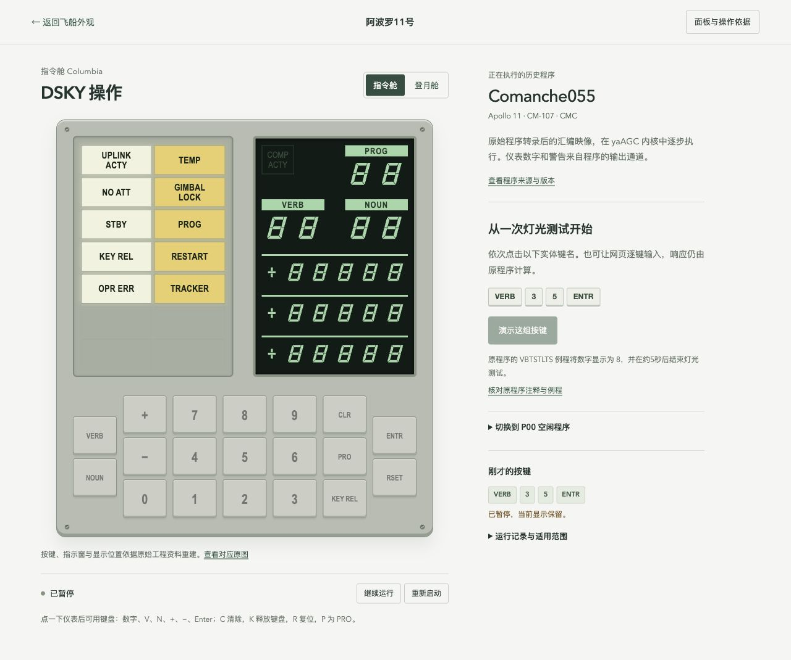

# 阿波罗11号飞船外观研究

可交互的三维外观研究网页，包含指令舱 CM-107、服务舱 SM-107 与登月舱 LM-5。以真实米制尺度展示模型，并可查看原始图纸和已核对的尺寸。

[打开在线网页](https://yun999-ccc.github.io/apollo11-explorer/)


## 机载计算机操作

从外观页点击“进入指令舱操作”或“进入登月舱操作”，也可点击正面的舱门。分别加载真实运行的 **Comanche055** 与 **Luminary099**，使用19个DSKY按键操作。

- [直接打开登月舱DSKY](https://yun999-ccc.github.io/apollo11-explorer/console/?craft=lm)
- [直接打开指令舱DSKY](https://yun999-ccc.github.io/apollo11-explorer/console/?craft=cm)
- 可手动输入 `VERB 3 5 ENTR` 做原程序灯光测试；逐键演示也写入相同输入通道。
- `VERB 3 7 ENTR 0 0 ENTR` 请求P00。暂停和重新启动是网页控制，置于实体面板外。
- 面板依据此前指定的五个资料入口及其链接的原始图纸。CM与LM指示灯分别追溯到1006387和1005025，不使用后期面板照片。
- 内核、ROM与固定版本源码均本地保存，启动前校验SHA-256；原始程序与模拟器移植依赖分别记录。
- 这不是完整飞行模拟器：未接入IMU、雷达和完整飞行动力学，也未加载任务飞行存储快照。

来源、图号、扫描PDF与校验值见网页“面板与操作依据”和 `assets/agc/provenance.json`；CPU及许可说明见 `vendor/agc/README.md`。`console/`按GPL-2.0-or-later发布，许可全文随附；历史资料保留原署名。



验证运行内核与原程序响应：

```sh
node validation/check-agc.mjs
```

## 当前精度

这是研究模型，**尚未达到完整、严格的图纸一致性**。主尺寸、四个脚垫和三根探针共23项数值已从实际几何测量核对，九项部件数量核对通过；这些检查不能代替全部外观复核。

着陆架现采用NASA TN D-6850：脚垫直径37 in、中心半径167.57 in、深度约7 in；探针总长5.6 ft、管径约1.25 in。报告未定义总长的测量端点，当前按分段中心线实现，属于待核的建模解释。保留球铰、每脚垫四条约束带与三根探针（前腿除外）。深度和管径的“约”不代表来源具有毫米精度。

仍待解决：LM训练图36 in与工程报告37 in的差异原因；支腿接点和探针折角；LM侧后热防护轮廓；舷窗、喷口、天线和附件定位；完整的多视图注册及轮廓比较。网页保留这些待核事项，不将推定几何标为精确复原。

## 使用

- 拖动旋转、滚轮或触控缩放。
- 分别聚焦三舱，或查看等比例组合。
- 立体、正视、侧视、俯视切换；键盘1–4切换视图，R复位。
- 尺寸标注、线框、分舱示意和参考网格。
- 点击模型部件查看依据；与原始扫描件对照。
- 保存当前视图、下载核对记录。

## 本地运行

无需安装依赖或构建。请在仓库根目录运行：

```sh
python3 -m http.server 4173 --bind 127.0.0.1
```

然后打开 http://127.0.0.1:4173/ 。网页使用ES模块，需要HTTP服务，不能直接以file协议运行。

几何验证（需要Node.js）：

```sh
node validation/check-model.mjs
```

## 文件

- `index.html` / `style.css`：界面与响应式布局。
- `app.js`：相机、交互、部件选择、图纸对照。
- `model.js`：按资料建立的米制三维几何和来源标记。
- `assets/`：NASA原始PDF、相关图页、预览和核对记录。
- `vendor/`：Three.js 0.180.0及MIT许可。
- `validation/`：几何、数量和尺寸检查脚本。

所有运行依赖保存在仓库中，应用运行时无需CDN、API密钥、数据库或第三方服务。GitHub Pages从`main`分支根目录发布。

## 资料与权利

依据NASA《Apollo 11 Press Kit》、1969年5月《LM-5 Structures Handout》与NASA TN D-6850《Lunar Module Landing Gear Subsystem》扫描资料制作；完整来源见`assets/reference_manifest.json`。本项目为独立研究展示，不代表NASA官方产品。历史资料的原有权利和署名信息保留；Three.js使用MIT许可。此仓库目前未另行为项目原创代码授予开源复用许可。


## 发射整体与内部装配

`launch/` 提供可旋转的整箭、顶部放大、发动机近景和带中文标注的 NASA 原始内部剖视图。首页原来的四个模型入口和独立飞船模型不变。

当前加载 `assets/saturn-v-apollo11-repaired.glb`，由 [NASA / Michael D. Carbajal 原模型](https://science.nasa.gov/3d-resources/saturn-v/)修订：分别配准主筒体33英尺、上部260英寸、服务舱154英寸直径及分段高度；修正国旗贴图的蓝色底纹；以开放桁架替代实心逃逸塔；重建五个开放式钟形喷管；调整涂层粗糙度。网页使用模型自身米制坐标，不再仅按整箭高度统一缩放。原始 GLB 保留为来源检查点。

6项主尺寸和5个喷管／4根主支柱检查通过；新 GLB 重新导入 Blender 后检查通过。`assets/launch-repair-report.json` 保留实际测量值、来源和未完成事项。F-1喷管曲线、管路、发动机安装点、逃逸系统局部细节和完整涂装仍未完成全部制造尺寸与照片注册，`strict_drawing_match` 保持 `false`。

复现：在独立新 Blender 后台进程中执行 `modeling/repair-launch.py`，传入 `--work` 指定工程源和校验输出目录。脚本只清理该独立进程的已确认工厂启动对象，保留原始模型，另存新 GLB 与 `.blend`。原始扫描、版本与校验值见 `assets/launch-sources.json`。


## 第二轮来源审计（2026-10-28）

当前发射模型由 `modeling/deep-launch.py` 生成，保留原NASA展示资产和旧修订脚本。
坐标采用米、Z向上；名义F‑1喷口平面为z=0，对应车辆站位−115英寸。
S‑II结构站位1541/2519和分离面1564/1760/2746.5由SA‑506手册确认。
上部3222.555/3258.555站位暂引SA‑501气动模型图，明确没有将其当作SA‑506竣工公差。
F‑1流道采用NASA SP-8120表1：喉径35英寸、出口140英寸、轴向长度158英寸；中间曲线和显示壁厚仍近似。R-3896-1图2-22的215.50英寸用于安装摆心至出口包络参考。早期139英寸、工程140英寸与任务新闻资料中“接近14英尺”的差异尚未完全解释。
桁架接点、发动机安装坐标、完整涂装及LM‑5收拢几何仍未完成认证，`strict_drawing_match` 保持false。

`launch/evidence.html` 展示原始文献页、适用范围、来源冲突、坐标公式和重新导入后的尺寸结果。
`validation/check-launch-export.py` 在全新Blender进程读取交付GLB，采用独立抄录的数值测量，不读取生成器参数。
通过软件检查仅代表实现一致，不等于实物或历史完整正确。四向模型预览不冒充四张独立历史照片注册。
原四个视图、指令舱/登月舱AGC操作页均保持原文件内容。

本轮浏览器检查因Work设置关闭本地浏览器访问而未执行；线上视觉与交互验收仍待完成。
