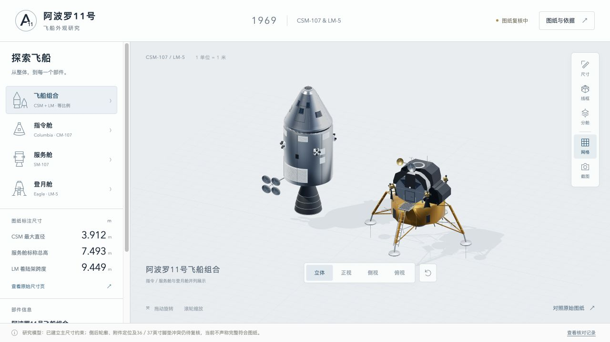

# 阿波罗11号飞船外观研究

可交互的三维外观研究网页，包含指令舱 CM-107、服务舱 SM-107 与登月舱 LM-5。以真实米制尺度展示模型，并可查看原始图纸和已核对的尺寸。

[打开在线网页](https://yun999-ccc.github.io/apollo11-explorer/)



## 当前精度

这是研究模型，**尚未达到完整、严格的图纸一致性**。主尺寸、四个脚垫和三根探针共23项数值已从实际几何测量核对，九项部件数量核对通过；这些检查不能代替全部外观复核。

着陆架现采用NASA TN D-6850：脚垫直径37 in、中心半径167.57 in、深度约7 in；探针总长5.6 ft、管径约1.25 in。报告未定义总长的测量端点，当前按分段中心线实现，属于待核的建模解释。保留球铰、每脚垫四条约束带与三根探针（前腿除外）。深度和管径的“约”不代表来源具有毫米精度。

仍待解决：LM训练图36 in与工程报告37 in的差异原因；支腿接点和探针折角；LM侧后热防护轮廓；舷窗、喷口、天线和附件定位；完整的多视图注册及轮廓比较。网页保留这些待核事项，不将推定几何标为精确复原。

## 使用

- 拖动旋转、滚轮或触控缩放。
- 分别聚焦三舱，或查看等比例组合。
- 立体、正视、侧视、俯视切换；键盘1–4切换视图，R复位。
- 尺寸标注、线框、分舱示意和参考网格。
- 点击模型部件查看依据；与原始扫描件对照。
- 保存当前视图、下载核对记录。

## 本地运行

无需安装依赖或构建。请在仓库根目录运行：

```sh
python3 -m http.server 4173 --bind 127.0.0.1
```

然后打开 http://127.0.0.1:4173/ 。网页使用ES模块，需要HTTP服务，不能直接以file协议运行。

几何验证（需要Node.js）：

```sh
node validation/check-model.mjs
```

## 文件

- `index.html` / `style.css`：界面与响应式布局。
- `app.js`：相机、交互、部件选择、图纸对照。
- `model.js`：按资料建立的米制三维几何和来源标记。
- `assets/`：NASA原始PDF、相关图页、预览和核对记录。
- `vendor/`：Three.js 0.180.0及MIT许可。
- `validation/`：几何、数量和尺寸检查脚本。

所有运行依赖保存在仓库中，应用运行时无需CDN、API密钥、数据库或第三方服务。GitHub Pages从`main`分支根目录发布。

## 资料与权利

依据NASA《Apollo 11 Press Kit》、1969年5月《LM-5 Structures Handout》与NASA TN D-6850《Lunar Module Landing Gear Subsystem》扫描资料制作；完整来源见`assets/reference_manifest.json`。本项目为独立研究展示，不代表NASA官方产品。历史资料的原有权利和署名信息保留；Three.js使用MIT许可。此仓库目前未另行为项目原创代码授予开源复用许可。
